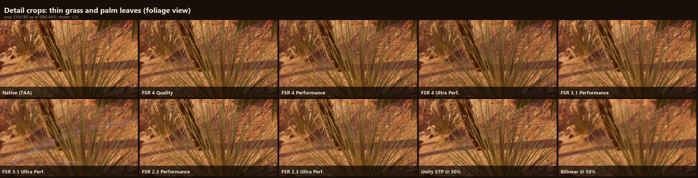
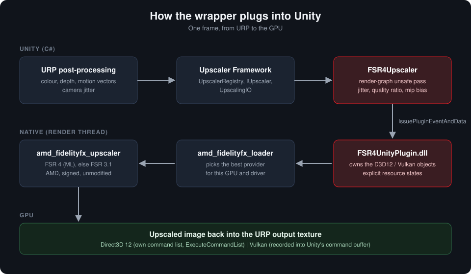

<div align="center">

# Unity FSR 4 Wrapper

**AMD FidelityFX Super Resolution for Unity 6 and URP: FSR 4 (ML) upscaling with automatic FSR 3.1 fallback, plus an optional frame-generation module.**

[](CHANGELOG.md)
[](https://unity.com)
[](https://docs.unity3d.com/Packages/com.unity.render-pipelines.universal@17.6/manual/index.html)
[](https://github.com/GPUOpen-LibrariesAndSDKs/FidelityFX-SDK)
[](#compatibility)
[](LICENSE.md)

[Installation](#installation) · [Quick start](#quick-start) · [Configuration](#configuration) · [Frame generation](#frame-generation) · [Test results](#validation-and-test-results) · [Scripting API](#scripting-api) · [Troubleshooting](#troubleshooting)

</div>

---

## Overview

This package registers FSR as a custom upscaler in Unity's **Upscaler Framework**. Once installed it appears in the URP asset next to Unity's built-in upscalers, with no custom render passes to wire up. FidelityFX selects the newest provider the GPU and driver support: FSR 4 (ML) where available, FSR 3.1 everywhere else.

The package is split into independent modules. The upscaler is the core; frame generation and the editor tooling are optional and can be deleted without breaking the rest.


> [!NOTE]
> **Pre-release, validated on one GPU.** The package has been run in Direct3D 12 Player builds on a Radeon RX 9060 XT (RDNA 4) with **Unity 6000.6.8f1** and **6000.7.0b9**: all FSR generations and quality modes, split-screen, frame generation, and the failure fallback. The measurements are in [Validation and test results](#validation-and-test-results). Vulkan and other GPUs (NVIDIA, Intel, older Radeon) have not been run on hardware. Frame generation is experimental: it is off by default, works in Player builds only, and its gain depends on whether the scene is GPU-bound.
> If something misbehaves, please [open an issue](../../issues) with the details listed under [Reporting issues](#reporting-issues).

### Project status

| Component | Direct3D 12 | Vulkan | Notes |
|---|---|---|---|
| Upscaling (FSR 4 ML / FSR 3.1 / FSR 2.3) | Implemented, validated on one GPU | Implemented, experimental | Main path is Direct3D 12. |
| Frame generation (2x interpolation) | Implemented, experimental, validated on one GPU | Implemented, experimental | Player builds only. Off by default. Net gain about 1.6x when GPU-bound, about none when CPU-bound. |
| Failure fallback (pink-screen protection) | Implemented, tested with simulated failures | Same code path | See [Failure handling](#failure-handling). |
| Hardware validation | Radeon RX 9060 XT only | Pending | Reports from other hardware are welcome. |

## Table of contents

- [Features](#features)
- [Compatibility](#compatibility)
- [Installation](#installation)
- [Quick start](#quick-start)
- [Configuration](#configuration)
- [Frame generation](#frame-generation)
- [Performance monitor](#performance-monitor)
- [Validation and test results](#validation-and-test-results)
- [Scripting API](#scripting-api)
- [Architecture](#architecture)
- [Troubleshooting](#troubleshooting)
- [Known limitations](#known-limitations)
- [Roadmap](#roadmap)
- [Building the native plugins](#building-the-native-plugins)
- [Reporting issues](#reporting-issues)
- [License](#license)

## Features

**Upscaling**

- FSR 4 (ML) with automatic fallback to FSR 3.1 on unsupported hardware. The provider can also be pinned to FSR 4, FSR 3.1 or FSR 2.3.
- Five quality presets from Native AA to Ultra Performance, plus Unity's custom scaling and dynamic resolution.
- Optional sharpening pass with adjustable strength.
- HDR input and inverted depth are detected from the camera and passed to FSR automatically.

**Frame generation (experimental)**

- FidelityFX frame interpolation on Direct3D 12 and Vulkan: one generated frame between each pair of rendered frames.
- Three ways to enable it: from code, with a scene component, or with a command-line flag.
- Optional frame pacing, HDR output support (PQ and scRGB), and FidelityFX debug overlays.
- Fails safe: unsupported setups report a status instead of crashing, and a fault inside the present hook switches generation off for the session.

**Integration and diagnostics**

- Native Upscaler Framework integration: select the upscaler in the URP asset.
- Modular assemblies that only meet through public hooks.
- In-game debug HUD: upscaler status, frame-time graph, CPU and GPU frame time, and separate rendered, generated and presented frame rates.
- Runtime diagnostics API: active backend, provider in use, GPU memory, dispatch counters, frame-generation statistics.
- Startup check that detects native plugins built against a different version of the package.
- Automatic failover between FSR providers, so a provider the GPU cannot run never leaves a pink or black image (see [Failure handling](#failure-handling)).
- One-click project setup from the **Tools > AchiraStudio > FSR4** menu.

## Compatibility

### Requirements

| | |
|---|---|
| **Unity** | 6000.6 or newer |
| **Render pipeline** | Universal RP 17.6 (Unity 6.6) or 17.7 (Unity 6.7). 17.6.0 is installed automatically as a dependency; both were tested. |
| **Platform** | Windows x64, Editor and Standalone |
| **Graphics API** | Direct3D 12 (recommended) or Vulkan (experimental) |
| **Anti-aliasing** | MSAA must be off. FSR replaces it. |

### GPU support

| Technology | Hardware |
|---|---|
| FSR 4 (ML) upscaling | Supported Radeon GPUs with a supporting driver |
| FSR 3.1 upscaling | Any DirectX 12 GPU |
| Frame generation 4.x | Radeon RX 9000 series |
| Frame generation 3.1 | Other GPUs |

The package never assumes which provider is running. The upscaler logs the provider it actually received (see [Quick start](#quick-start)) and exposes it through [`FSR4Diagnostics.ProviderInUse()`](#diagnostics).

> [!NOTE]
> FSR 4 (ML) may be unavailable on Vulkan, because Unity does not enable the device extensions it needs. Use Direct3D 12 if you need the ML path.

## Installation

### Option 1: Package Manager, git URL (recommended)

1. In Unity, open **Window > Package Manager**.
2. Click **+ > Add package from git URL...**
3. Paste the URL and click **Add**:

   ```
   https://github.com/AchiraStudio/unity-fsr4-wrapper.git
   ```

To pin a release, append its tag, for example `...unity-fsr4-wrapper.git#v0.2.0`. To try the work in progress, append the branch instead: `...unity-fsr4-wrapper.git#beta`. The `beta` branch can contain features that have not been tested on hardware yet (see the [changelog](CHANGELOG.md)).

Alternatively, add the dependency directly to `Packages/manifest.json`:

```json
{
  "dependencies": {
    "com.achirastudio.fsr4": "https://github.com/AchiraStudio/unity-fsr4-wrapper.git"
  }
}
```

> [!NOTE]
> The package bundles AMD's signed FidelityFX DLLs (about 150 MB), so the first import takes a moment. Git must be installed and on your `PATH` for Unity to resolve git URLs.

### Option 2: Local copy

1. Clone or download this repository.
2. Copy the folder into your project as `Packages/com.achirastudio.fsr4`, or use **Package Manager > + > Add package from disk...** and select `package.json`.

## Quick start

All setup commands live under **Tools > AchiraStudio > FSR4**. Nothing runs automatically; each item only changes project settings when you click it.

1. Run **1. Enable Upscaler Framework define**. This adds the `ENABLE_UPSCALER_FRAMEWORK` scripting define for Windows Standalone. The package's runtime assemblies only compile when it is set.
2. Run **2. Use Direct3D12 only**, or **2b. Use Vulkan only** to test the Vulkan backend. Then **restart the Editor** so the Editor itself runs on that API.
3. Select your URP asset, set the upscaler to **AMD FSR 4 (Custom Wrapper)**, and turn **MSAA off**.
4. Enter Play mode and check the Console.

A working setup logs two lines:

```
[FSR4] Providers: [...]
[FSR4] Context active. Provider in use: ...
```

The first lists every FSR provider available on the machine. The second names the provider the upscaler is actually using. If you see a warning instead, it states the cause; see [Troubleshooting](#troubleshooting).

**Tools > AchiraStudio > FSR4 > Check status** prints the state of the scripting define, the Editor's graphics API, and whether each required DLL is present.

## Configuration

Upscaler settings are stored with the URP asset and edited in its inspector.

### Quality presets

Used when the upscaler's resolution mode is set to quality mode. With custom scaling, Unity's own scale setting applies instead.

| Preset | Upscale ratio per axis | Render resolution at 4K output |
|---|---|---|
| Native AA | 1.0x | 3840 x 2160 |
| Quality (default) | 1.5x | 2560 x 1440 |
| Balanced | 1.7x | 2258 x 1270 |
| Performance | 2.0x | 1920 x 1080 |
| Ultra Performance | 3.0x | 1280 x 720 |

### Options

| Option | Default | Description |
|---|---|---|
| **Quality Mode** | Quality | Render-resolution preset (see above). |
| **Provider** | Auto | Which FSR generation to run. *Auto* picks the newest the GPU supports. *FSR 4*, *FSR 3* and *FSR 2* pin a generation; if the requested one is unavailable, the package logs a warning and uses automatic selection. |
| **Version Override** | 0 | Advanced. Pins an exact FidelityFX version id when Provider is Auto. Ids are logged at startup and can differ between machines. |
| **Auto Exposure** | On | Lets FSR compute exposure itself. URP provides no exposure texture, so leave this on. |
| **Enable Sharpening** | Off | Runs FSR's sharpening pass after upscaling. |
| **Sharpness** | 0.5 | Sharpening strength, 0 to 1. |
| **Debug Checking** | Off | Asks the FidelityFX runtime to validate its inputs and report problems. Slower; intended for bring-up. |
| **Invert Jitter** | Off | Flips the sign of the jitter passed to FSR. Try it if the image shimmers or looks doubled while the camera is still. |
| **Debug View** | Off | Draws FSR's own debug visualization into the output. Allocates extra memory. |

Changing the quality preset or the provider recreates the FSR context. All other options are read every frame.

### Temporal tuning

Enable **Enable Tuning** to apply the values below. Providers ignore keys they do not support; FSR 4 (ML) may ignore several.

| Option | Default | Effect |
|---|---|---|
| **Velocity Factor** | 1 | 0 can improve the temporal stability of bright pixels. |
| **Reactiveness Scale** | 1 | Higher values make the reactive mask reduce ghosting more. |
| **Shading Change Scale** | 1 | Higher values react more strongly to shading changes. |
| **Accumulation Added Per Frame** | 0.333 | Lower values give less ghosting but more flicker on thin features. |
| **Min Disocclusion Accumulation** | -0.333 | Higher values may reduce flicker around swaying thin objects. |

## Frame generation

> [!IMPORTANT]
> Frame generation is experimental, **off by default**, and works in **Player builds only**. In the Editor the module reports a status and does nothing else.

The module interpolates one frame between each pair of rendered frames and presents it ahead of the real one, so the display receives about twice the rendered frame rate.

### Requirements

- A Player build on Direct3D 12 or Vulkan.
- The FSR upscaler active on the camera. Frame generation takes its depth, motion vectors and camera data from the upscale pass.
- **VSync off** on Direct3D 12.
- A base frame rate of roughly 30 fps or more.
- One camera drives generation per frame. In split-screen it pauses; see [Split-screen and multiple cameras](#split-screen-and-multiple-cameras).

### Enabling

| Method | How |
|---|---|
| Code | `FSR4FrameGeneration.enabled = true;` |
| Component | Add **AchiraStudio > FSR4 Frame Generation Controller** to a GameObject. |
| Command line | Launch the Player with `-fsr4-framegen`. |

A minimal on-screen toggle is available under **Package Manager > AchiraStudio FSR > Samples > Frame generation toggle**.

### States

`FSR4FrameGeneration.state` reports what the module is doing, and `FSR4FrameGeneration.statusMessage` gives the reason in plain text.

| State | Meaning |
|---|---|
| `Idle` | Nothing has happened yet, or frame generation is disabled. |
| `Active` | Frames are being generated. |
| `UnsupportedApi` | The graphics API is not Direct3D 12 or Vulkan. |
| `DllMissing` | The AMD loader or frame-generation DLL could not be loaded. |
| `NoSwapchain` | Running in the Editor, or on Vulkan the swapchain was created before the plugin's hook. |
| `ContextFailed` | FidelityFX could not create the frame-generation context. |
| `UnsupportedFormat` | The backbuffer format is not supported. |
| `Stalled` | The present hook did not keep up or faulted, and generation switched itself off. Disable and re-enable to retry. |
| `PluginUnavailable` | `FSR4FrameGen.dll` could not be loaded or does not match this package version. |

### HUD-less input (experimental)

Frame generation interpolates the whole backbuffer, so animated screen-space UI (a health bar, a minimap, floating text) is interpolated along with the scene and can ghost. FidelityFX can avoid that when it also gets an image of the frame without the UI and compares the two. The **FSR4 HUD-less Capture** renderer feature provides that image.

1. Select your URP renderer asset and click **Add Renderer Feature > FSR4 HUD-less Capture**.
2. Set `FSR4FrameGeneration.hudless = true`, tick it on the Frame Generation Controller, tick it in the debug HUD, or launch with `-fsr4-hudless`.
3. Check `FSR4FrameGeneration.hudlessStatus`. It reads `Active` once frames are being handed over, and otherwise says what is missing.

It needs Direct3D 12, SDR output, URP's overlay UI (Screen Space - Overlay canvases or UI Toolkit drawn by URP), and an `FSR4FrameGen.dll` built from these sources (the prebuilt DLL is). Turn off FXAA and dithering on the camera: URP applies them after the capture, so they would be read as UI. The feature copies the image once per frame at display resolution. On a Radeon RX 9060 XT it runs (`hudlessStatus` reads `Active`) and gives a small reduction in artifacts around fast-moving HUD elements, 3 to 4 % by the metric in [HUD ghosting](#hud-ghosting), which is within the capture-to-capture spread. Compare with it off before relying on it.

For how the module works, latency, the diagnostic log and the Direct3D 12 diagnostic modes, read the [Frame generation guide](Documentation~/Frame-generation.md).

## Split-screen and multiple cameras

**Upscaling works per view.** URP creates one upscaler context for every camera, keyed by the camera, and sizes it to that camera's viewport. In a split-screen each player's view therefore has its own FSR context and temporal history, at its own render and display resolution, and nothing is shared between views. There is nothing to configure: give each player a base camera with its own viewport rect. URP composes the viewports into the backbuffer itself, so no extra compositor is needed. Contexts are created when a camera first renders, re-created when its viewport size changes (a player joins or leaves), and released by URP a few frames after the camera stops rendering.

Keep in mind that upscaling cost scales with the number of views and with the pixels in each, and that each view needs its own context memory. The debug HUD and the diagnostics report list every active view with its render and display resolution.

**Frame generation pauses in split-screen.** It interpolates the whole backbuffer from one camera's depth and motion vectors, which is only correct when that camera fills the screen. While two or more base cameras that render to the screen each cover at least 20% of it, frame generation pauses: frames are presented as usual, nothing is interpolated, and the HUD says why. It resumes, with a history reset, as soon as one view is left. Overlay cameras (camera stacking), render-to-texture cameras and small picture-in-picture windows do not count as views.

| Setting | Effect |
|---|---|
| `FSR4FrameGeneration.pauseInSplitScreen` (default `true`) | Set to `false` to let the first upscaled camera drive generation anyway. The other views will interpolate wrongly. |
| `FSR4FrameGeneration.sourceCamera` | Naming a camera turns the pause off, because you chose the camera that drives it. |
| `isSplitScreenDetected`, `screenViewCount`, `pausedForSplitScreen`, `splitScreenPausedFrames` | Read-only state for your UI and for tests. |

Interpolating a split-screen correctly needs depth and motion vectors for the whole screen, composed from every view with per-view scaling. That is not implemented and would need hardware validation, so it is listed in the roadmap.

## Performance monitor

The debug HUD is an in-game window that shows what the package is doing. It works in the Editor and in Player builds.

| Block | Shows |
|---|---|
| **Upscaler** | Status or the reason it is not running, backend, provider in use, render and display resolution, quality preset, GPU memory, dispatch counters. |
| **Performance** | Rendered frame rate, average and worst frame time, 1% and 0.1% lows over the last 30 seconds, CPU and GPU frame time, and a frame-time graph of the last 180 frames. |
| **Frame generation** | On/off and pacing toggles, state, provider, and rendered + generated = presented frame rates, with the raw frame counters. |

To show it, add the **AchiraStudio > FSR4 Debug HUD** component to a GameObject, or launch the Player with `-fsr4-hud`. **F10** hides and shows the window; the key, the graph and the window scale are set on the component.

CPU and GPU frame times come from Unity's `FrameTimingManager`. In release builds they need **Frame Timing Stats** enabled in Player Settings.

Other modules can add their own block by implementing `IFSR4HudSection` and registering it with `FSR4HudSections.Register`.

### Diagnostics report and benchmark

The window's **Tools** row has three buttons:

- **Copy report** puts a plain-text report on the clipboard: Unity version, OS, CPU, GPU, graphics API, VRAM, display and VSync settings, upscaler status, provider in use, and the frame-generation counters. Paste it into a bug report. It contains no user name, machine name or device id. The same text is available from code with `FSR4DiagnosticsReport.Build()`, and other modules add a block with `FSR4ReportSources.Register`.
- **Save report** writes the same text to `fsr4-report-<time>.txt` in `Application.persistentDataPath`.
- **Run benchmark** records frame times for 30 seconds after a 5 second warm-up and writes `fsr4-benchmark-<time>.csv` (one row per frame) and `.json` (average, median, worst, 1% and 0.1% lows, and the report from the start and the end of the run) to `Application.persistentDataPath`.

From code, call `FSR4Benchmark.Start(warmupSeconds, durationSeconds)` and listen to `FSR4Benchmark.Completed`. From the command line, `-fsr4-benchmark -fsr4-benchmark-warmup 5 -fsr4-benchmark-seconds 30 -fsr4-benchmark-quit` runs one benchmark and exits. The times are the frame times of the rendered frames, so with frame generation on the displayed rate is higher than the benchmark shows; the report's frame-generation counters let you relate the two.

## Validation and test results

Everything here was measured in Windows Player builds (Direct3D 12) of a Unity URP project, scripted with `-fsr-run` so that settings, camera and timing are identical between runs. Raw results are in [`Documentation~/test-results`](Documentation~/test-results).

| | |
|---|---|
| Scene | Unity's Oasis sample |
| Unity | **6000.7.0b9** (6.7 beta, URP 17.7) and **6000.6.8f1** (6.6, URP 17.6) |
| Machine | Radeon RX 9060 XT 16 GB (RDNA 4, driver 32.0.32015), Ryzen 5 4500, Windows 11, 1920x1080 @ 144 Hz |
| Method | 3 to 6 s averages per setting; 100+ frames of temporal convergence before each screenshot |

| Question | Result |
|---|---|
| Do FSR 4, 3.1 and 2.3 work in every quality mode? | **Yes**, 15 of 15 combinations give the right render resolution and a clean image. |
| Do the quality modes raise the frame rate? | **GPU-bound: yes**, 1.9x (Quality) to 4.3x (Ultra Performance). **CPU-bound: no**, render resolution is not the bottleneck. |
| Does split-screen work? | **Yes**, one FSR context per view, correct images and scaling. |
| Does frame generation work and show in an FPS counter? | **Yes**, rendered, generated and presented fps are shown separately. **About 1.6x when GPU-bound, about 1.0x when CPU-bound.** It never doubles fps in these tests. |
| Does the HUD ghost? | **FSR alone: no. Frame generation: faint artifacts on fast-moving HUD edges.** HUD-less input is active and reduces them slightly. |
| Pink or black image on a GPU that cannot run the chosen provider | **Fixed**: automatic failover, tested with simulated failures. |
| Unity 6.6 and 6.7 | 0 compile errors on both; a real 6.6 Player ran all 15 modes. |

### FSR quality modes

All three generations were run at all five quality modes on the same camera. The provider is read back from the native plugin (`FSR4Diagnostics.ProviderInUse()`): FSR 4.1.2, 3.1.6 and 2.3.4.

| Mode | Scale | Render resolution (1080p output) |
|---|---|---|
| Native AA | 1.0x | 1920 x 1080 |
| Quality | 1.5x | 1280 x 720 |
| Balanced | 1.7x | 1129 x 635 |
| Performance | 2.0x | 960 x 540 |
| Ultra Performance | 3.0x | 640 x 360 |


Zoomed on thin grass and palm leaves, the hardest content for an upscaler. FSR 4 keeps individual blades even at Ultra Performance; bilinear at 50 % is blocky.



Unity's built-in upscalers at comparable scales: [vista](Documentation~/images/results/legacy_vista.jpg), [foliage](Documentation~/images/results/legacy_foliage.jpg). The PSNR figures on the collages are against native + TAA and are only a rough guide; judge by eye.

### Performance

**At 1080p this scene is CPU-bound** on the test machine (a Ryzen 5 4500 with a much faster GPU), so every mode lands in the same band: native TAA 195 to 216 fps, FSR modes 147 to 242 fps, bilinear at 50 % 201 to 246 fps. The quality modes cannot help when the render resolution is not the bottleneck.


To measure what the upscaler does for a GPU-bound game, the test project adds a clearly synthetic **render-resolution GPU load**: a full-screen shader pass before the upscaler, whose cost scales with pixel count like heavy shading in a real game. With it, native 1080p runs at about 41 fps.


| fps, GPU-bound | Native AA | Quality | Balanced | Performance | Ultra Perf. |
|---|---|---|---|---|---|
| FSR 4.1.2 | 40 | 76 (1.9x) | 91 (2.2x) | 114 (2.8x) | 174 (4.3x) |
| FSR 3.1.6 | 39 | 78 (1.9x) | 94 (2.3x) | 118 (2.9x) | 186 (4.6x) |
| FSR 2.3.4 | 40 | 78 (1.9x) | 94 (2.3x) | 119 (2.9x) | 185 (4.5x) |

Native 1080p TAA: 41 fps. Unity STP at 67 / 50 %: 78 / 121 fps. FSR 1.0 spatial at 50 %: 125 fps. FSR 4 Native AA is slightly slower than native TAA (40 vs 41) because of the ML pass, and FSR 4 costs a little more per frame than FSR 3.1 or 2.3.

### Split-screen

Two base cameras, each upscaled by its own FSR context (the debug HUD lists both). Each half is 960 x 1080 output.


| fps | Native TAA | Quality | Balanced | Performance | Ultra Perf. |
|---|---|---|---|---|---|
| GPU-bound, FSR 4 | 38 | 68 | | 96 | 136 |
| CPU-bound, FSR 3.1 | 161 | 151 | 154 | 154 | 154 |


GPU-bound, split-screen scales like a single view (1.8x to 3.6x). CPU-bound it sits at about 150 fps: two cameras mean two culls and two shadow passes, and each FSR view adds a little CPU cost, so FSR is 4 to 10 % slower than native there and Unity's STP (191 fps) is faster.

### Frame generation results

The test project's overlay (top right) shows **rendered + generated = presented** fps, measured with `FSR4FrameRateMeter`.


| Scenario | Off | On (rendered + generated) | Presented | vs off |
|---|---|---|---|---|
| GPU-bound, FSR 4 Quality | 76 | 62 + 62 | 123 | **1.6x** |
| GPU-bound, pacing off | 76 | 60 + 60 | 119 | 1.6x |
| CPU-bound 1080p, FSR 3.1 Quality | 210 | 99 + 99 | 198 | **0.9x to 1.0x** |
| CPU-bound, pacing off | 210 | 100 + 100 | 199 | 0.95x |
| CPU-bound, HUD-less on | 210 | 111 + 111 | 222 | 1.05x (run-to-run variance) |

**Why it is not 2x.** Turning frame generation on stretches the real frame from 4.7 ms to about 10 ms at 1080p CPU-bound (13 to 16 ms when GPU-bound). That extra 3 to 5 ms per real frame is what cancels most of the doubling. The native plugin's log ([`FSR4FrameGen.perf.log`](Documentation~/test-results/FSR4FrameGen.perf.log)) shows about 8.5 ms inside its present hook per real frame, 3.5 ms of it the deliberate pacing wait. Switching pacing off did not shorten the frame (rendered fps stayed at about 99), so the cost is not the pacing itself. It sits in the present path and the extra GPU work: the plugin copies the backbuffer, interpolates, and issues more than one `Present` per real frame to keep Unity's backbuffer index valid. It was not profiled further.

Practical guidance from these numbers: frame generation pays off when the GPU is the limit and the base rate is below about 100 fps; on a CPU-bound scene at 200+ fps it gains nothing, so leave it off.

### HUD ghosting

The test project animates a HUD stress panel (bouncing ball, scrolling ticker, moving marker, growing bar, rotating dial) as a **UI Toolkit overlay**, a **screen-space camera canvas** and a **world-space canvas**. Generated frames only exist in the swapchain, so the frame-generation captures are desktop captures, not in-engine screenshots.


Zoomed on the ball track (screen-space camera UI), four frames each:


- **FSR alone:** the HUD is sharp and does not ghost.
- **Frame generation:** generated frames show small crumbling at the trailing edge of fast-moving HUD elements, over a busy background.
- **HUD-less input** is active and reduces that slightly. Speckle energy next to the ball (mean of 8 desktop captures, lower is cleaner; [data](Documentation~/test-results/hud_speckle.json)):

| HUD type | FSR only (reference) | Frame gen | Frame gen + HUD-less |
|---|---|---|---|
| Overlay UI | 5.40 | 4.92 | 4.78 |
| Screen-space camera | 8.31 | 8.23 | 7.95 |
| World-space | 5.34 | 4.93 | 4.75 |

The 3 to 4 % reduction is consistent in direction but within one standard deviation of the capture-to-capture spread. Treat it as a small improvement, not a fix.

### Failure handling

**Cause of the pink or black image.** A FidelityFX context is created lazily on the render thread. If creation, or every dispatch, failed (a provider the GPU cannot run, a size or flag the driver refuses), the native side returned and the upscaler's output texture stayed unwritten. The managed side only learned of it afterwards and never recovered.

**What the package does now.**

1. Each provider is **probed once** with a throw-away context before first use.
2. A provider that fails (at the probe, at creation, or by failing every dispatch) is **blocked**, and the next one is used: FSR 4 > FSR 3.1 > FSR 2.3 > automatic.
3. A new context's output is used only **after the render thread confirms** the context exists. Until then the frame keeps the un-upscaled colour.
4. If nothing works, the upscaler reports itself unsupported (`FSR4Upscaler.hasFailed`, `runtimeFailureReason`; events `RuntimeFailed` and `ProviderFailed`) and records no pass, so URP shows its normal image. On URP 17.7 the framework then moves on to the next upscaler in its priority list.

Tested in a Player with simulated failures (`-fsr4-simulate-failure[=probe|all]`):

| Switch | What fails | Result |
|---|---|---|
| `-fsr4-simulate-failure=probe` | the first provider's probe | falls over to FSR 3.1.6, normal image ([log](Documentation~/test-results/failover_sim_probe.log)) |
| `-fsr4-simulate-failure` | creation on the render thread (`ffxCreateContext` code 4) | blocks that provider and recovers with a working one ([log](Documentation~/test-results/failover_sim_render.log)) |
| `-fsr4-simulate-failure=all` | every provider | the upscaler disables itself, a normal image is shown ([log](Documentation~/test-results/failover_sim_all.log)) |

Verified only on a Radeon RX 9060 XT; the paths for GPUs without FSR 4 are exercised by these simulations, not on other hardware.

### Unity 6.6 and 6.7

The package selects its registration API at compile time (`FSR4_UPSCALER_ID_API`, set for `com.unity.render-pipelines.core` 17.7 and newer), so one code base serves both.

| | 6000.6.8f1 (URP 17.6) | 6000.7.0b9 (URP 17.7) |
|---|---|---|
| Package compiles | 0 errors | 0 errors (Unity's `UAL0010` / `UAL0013` static-state warnings only) |
| Registered and selectable | yes ("AMD FSR 4 (Custom Wrapper)") | yes (`achirastudio.fsr4`) |
| Real D3D12 Player | FSR 4.1.2, 3.1.6, 2.3.4 x 5 modes, resolutions correct ([log](Documentation~/test-results/unity66_compat.log)) | full test run |

On 6.6 the URP asset needs an `FSR4Options` sub-asset, which the asset inspector creates when you pick the upscaler.

### Test project

The test project (Oasis scene, in-game graphics menu, performance overlay, split-screen rig, HUD stress test, GPU-load pass and scripted runner) lives on the repository's `demo` branch. Run it from a Player build:

```
FSRShowcase.exe -fsr-run matrix,perf,motion,splitscreen,framegen,hud,menu -fsr-out <folder> [-fsr-load 1.0] [-fsr-res 1920x1080]
```

| Flag | Purpose |
|---|---|
| `-fsr-reset`, `-fsr-safe` | clear saved settings; start with Unity's STP and no frame generation |
| `-fsr4-simulate-failure[=probe\|all]` | exercise the failover path (package switch) |
| `-fsr4-hud`, `-fsr4-framegen`, `-fsr4-hudless`, `-fsr4-benchmark` | package switches: debug HUD, frame generation, HUD-less, benchmark |


## Scripting API

All runtime types compile only when `ENABLE_UPSCALER_FRAMEWORK` is defined. Wrap code that references them in `#if ENABLE_UPSCALER_FRAMEWORK`, as the bundled sample does.

### Frame generation

Namespace `AchiraStudio.FSR4.FrameGeneration`.

| Member | Description |
|---|---|
| `FSR4FrameGeneration.enabled` | Requested state. Generation runs when this is true and `state` becomes `Active`. |
| `FSR4FrameGeneration.pacing` | Waits half a frame interval between the generated and the real frame. On by default. |
| `FSR4FrameGeneration.debug` | `FSR4FrameGenDebug` overlay flags: `TearLines`, `ResetIndicators`, `DebugView`, `PacingLines`. |
| `FSR4FrameGeneration.isAvailable` | False when the native plugin is missing or the graphics API is unsupported. |
| `FSR4FrameGeneration.state` | Current `FSR4FrameGenState`. |
| `FSR4FrameGeneration.statusMessage` | Latest diagnostic message from the native plugin. |
| `FSR4FrameGeneration.backendName` | `"Direct3D12"`, `"Vulkan"` or `"none"`. |
| `FSR4FrameGeneration.providerInUse` | Version name of the frame-generation provider FidelityFX selected. Empty until generation has started. Requires a rebuilt `FSR4FrameGen.dll`. |
| `FSR4FrameGeneration.sourceCamera` | Camera that drives frame generation. Null (default) uses the first camera upscaled in each frame. |
| `FSR4FrameGeneration.GetStats()` | Returns an `FSR4FrameGenStats` snapshot. |

`FSR4FrameGenStats` fields:

| Field | Description |
|---|---|
| `state` | State at the time of the snapshot. |
| `preparedFrames` | Rendered frames handed to frame generation. |
| `generatedFrames` | Frames generated and submitted for presentation. |
| `passedThroughFrames` | Presents passed through without a generated frame. |
| `baseFrameMs` | Smoothed interval between rendered frames, excluding the module's own pacing wait. |
| `lastPresentHookMs` | CPU time spent inside the last generated present. |
| `vramBytes` | Approximate GPU memory used by frame generation. |
| `lastFfxReturnCode` | Last FidelityFX return code that was not a success. |

#### Rendered and generated frame rates

`FSR4FrameRateMeter` measures the two rates separately. Create one, call `Update()` every frame and read the properties:

```csharp
#if ENABLE_UPSCALER_FRAMEWORK
using AchiraStudio.FSR4.FrameGeneration;
using UnityEngine;

public class FrameRateReadout : MonoBehaviour
{
    readonly FSR4FrameRateMeter m_Meter = new FSR4FrameRateMeter();

    void Update()
    {
        m_Meter.Update();
        float rendered  = m_Meter.renderedFps;    // frames the game rendered
        float generated = m_Meter.generatedFps;   // frames added by frame generation
        float presented = m_Meter.presentedFps;   // rendered + generated
    }
}
#endif
```

Both rates are measured: rendered frames from Unity's frame counter, generated frames from the native plugin's counter. A generated frame is counted when its present call succeeded, which does not confirm that it reached the display.

### Diagnostics

Namespace `AchiraStudio.FSR4`.

| Member | Description |
|---|---|
| `FSR4Diagnostics.BackendName()` | Graphics backend the native upscaler attached to. |
| `FSR4Diagnostics.ProviderInUse()` | FSR provider of the most recently dispatched context. Empty until the first dispatch. |
| `FSR4Diagnostics.TryGetContextMemory(out total, out aliasable)` | GPU memory owned by the upscaler context, in bytes. |
| `FSR4Diagnostics.TryGetDispatchCounts(out attempts, out executed)` | Upscale dispatches that reached the render thread, and how many were submitted to the GPU. |
| `FSR4Stats.renderResolution`, `displayResolution` | Resolutions the upscaler saw on the last frame it ran. |
| `FSR4Stats.quality`, `provider`, `resolutionMode` | Options in effect on that frame. |
| `FSR4Stats.notReadyReason` | Why the upscaler could not initialize. Empty when it is ready. |
| `FSR4Stats.skipReason` | Why the last pass did nothing. Empty when it dispatched. |

### Extension hook

`FSR4Hooks.UpscaleDispatched` is raised inside the render graph immediately after the upscale dispatch. Listeners receive the command buffer and an `FSR4FrameData` with the frame's camera, native depth, motion-vector and color textures, resolutions, jitter and camera data. The frame-generation module is built entirely on this hook.

The native pointers are valid only for the duration of the callback, and may only be used by commands added to the same command buffer.

## Architecture

### Modules

Each module is its own assembly. Delete the ones you do not need.

| Module | Assembly | Folder | To remove, delete |
|---|---|---|---|
| **Core upscaler** (required) | `AchiraStudio.FSR4.Runtime` | `Runtime/Core` | n/a |
| **Frame generation** | `AchiraStudio.FSR4.FrameGeneration` | `Runtime/FrameGeneration` | The folder, `FSR4FrameGen.dll` and `amd_fidelityfx_framegeneration_*.dll` |
| **Debug HUD** | `AchiraStudio.FSR4.DebugHud` | `Runtime/DebugHud` | The folder |
| **Editor menu** | `AchiraStudio.FSR4.Editor` | `Editor` | The folder |

### Upscaling pipeline



```
URP post-processing
  -> Unity Upscaler Framework (UpscalerRegistry / IUpscaler / UpscalingIO)
    -> FSR4Upscaler (C#): render-graph unsafe pass, output texture + parameter block
      -> IssuePluginEventAndData -> FSR4UnityPlugin.dll (render thread)
        -> amd_fidelityfx_loader_{dx12,vk}.dll -> amd_fidelityfx_upscaler_{dx12,vk}.dll (AMD, signed)
```

Jitter, quality ratios, mip bias and resolution are computed in C#. The native plugin owns the Direct3D 12 and Vulkan objects. On Direct3D 12 the FSR work is recorded into the plugin's own command list with explicit resource states; on Vulkan it is recorded into Unity's command buffer.

### Frame-generation pipeline

FidelityFX normally replaces the engine's swapchain, which Unity's plugin API does not allow. `FSR4FrameGen.dll` therefore runs the SDK in manual mode and drives presentation itself:

1. After the upscale pass, the module records a FidelityFX *prepare* dispatch with the frame's depth, motion vectors, jitter and camera vectors.
2. The plugin hooks the swapchain present: the `IDXGISwapChain` vtable on Direct3D 12, `vkQueuePresentKHR` through Unity's interception API on Vulkan.
3. When Unity presents frame N, the plugin copies the backbuffer, generates the frame between N-1 and N, presents it, then presents frame N.

### Repository layout

```
.
├── package.json              UPM manifest
├── Runtime/Core/             Upscaler (required)
├── Runtime/FrameGeneration/  Frame generation (optional, experimental)
├── Runtime/DebugHud/         In-game performance monitor (optional)
├── Editor/                   Tools > AchiraStudio > FSR4 menu
├── Plugins/x86_64/           Native plugins and AMD's signed DLLs
├── Native~/                  C++ sources and CMake build (not imported by Unity)
├── Documentation~/           Guides, test-result images and raw data (not imported by Unity)
└── Samples~/                 Importable samples
```

## Troubleshooting

| Symptom | What to try |
|---|---|
| Nothing happens | Read the `[FSR4]` warning in the Console. It names the cause: wrong graphics API, missing DLL, or a failed probe. `FSR4Stats.notReadyReason` holds the same text. |
| Pink or black image, or no upscaling on some GPUs | The upscaler fails over automatically (FSR 4 > FSR 3.1 > FSR 2.3 > automatic) and, if nothing works, disables itself so URP shows its normal image. Look for `[FSR4] ... failed on this machine` in the log, or read `FSR4Upscaler.runtimeFailureReason`. Test the paths with `-fsr4-simulate-failure[=probe\|all]`. |
| Upscaler is selected but the image is not upscaled | Turn MSAA off in the URP asset. `FSR4Stats.skipReason` reports why a pass was skipped. |
| Shimmer or a doubled image while the camera is still | Enable **Invert Jitter**. |
| Ghosting trails | Check that every moving object writes motion vectors. Enable **Debug Checking** to have FidelityFX validate its inputs; its messages go to the debugger output (a debugger or Sysinternals DebugView shows them). |
| "out of date ... Rebuild it" in the log | The native plugin does not match the C# structs. See [Building the native plugins](#building-the-native-plugins). |
| FSR 4 (ML) unavailable on Vulkan | Expected: Unity does not enable the required device extensions. Check the `[FSR4] Providers:` line, or use Direct3D 12. |
| Frame generation stays in `NoSwapchain` | It only runs in Player builds. On Vulkan, the plugin must also be preloaded, which the bundled `.meta` file configures. |
| Frame generation switches to `Stalled` | Read `FSR4FrameGeneration.statusMessage` and `FSR4FrameGen.log` next to the DLL. See the [Frame generation guide](Documentation~/Frame-generation.md#diagnostics). |
| Cannot rebuild a DLL | Close Unity. A loaded native plugin stays locked. |

## Known limitations

**Upscaling**

- Reactive and transparency masks are not wired up. Particles, glass and other translucent effects rely on FSR's built-in handling.
- No exposure texture is passed, because URP does not produce one. Auto exposure is used instead.
- The FidelityFX Denoiser and Radiance Cache are not included; they require ray tracing.

**Frame generation**

- Player builds only.
- One generated frame per rendered frame (2x).
- One camera drives generation per frame, because the whole backbuffer is interpolated from one camera's depth and motion vectors. Other upscaled cameras in the same frame are ignored; `FSR4FrameGeneration.sourceCamera` selects the camera. In split-screen, frame generation pauses (see [Split-screen and multiple cameras](#split-screen-and-multiple-cameras)); upscaling keeps working per view.
- On Direct3D 12 each rendered frame costs several extra full-screen copies and presents, which keep Unity's backbuffer index in step. Measured on a Radeon RX 9060 XT at 1080p, frame generation lengthens every real frame by about 3 ms (GPU-bound) to 5 ms (CPU-bound), so presented fps is about 1.6x when GPU-bound and about 1.0x at 200+ fps on a CPU-bound scene. Turning pacing off does not shorten the frame. See [Frame generation results](#frame-generation-results).
- Direct3D 12 requires VSync off.
- Adds about one frame of latency, because the real frame is held back for the interpolated one.
- The UI is part of the backbuffer, so animated UI can ghost. The experimental [HUD-less input](#hud-less-input-experimental) reduces this on Direct3D 12 with SDR output; it is not implemented for Vulkan or HDR output, and it only covers UI that URP draws after its final blit (Screen Space - Overlay canvases, UI Toolkit). UI rendered into the scene (Screen Space - Camera, World Space) cannot be separated.
- Supported backbuffer formats: R8G8B8A8, B8G8R8A8, R10G10B10A2 and R16G16B16A16_FLOAT.

## Roadmap

Planned work, in rough priority order.

1. Hardware validation beyond one GPU: Direct3D 12 on NVIDIA, Intel and older Radeon, and Vulkan, with a published compatibility matrix. (Direct3D 12 on a Radeon RX 9060 XT is done, including the HUD-less input; see [test results](#validation-and-test-results).)
2. A cheaper Direct3D 12 present path for frame generation (it adds 3 to 5 ms per real frame today, which cancels the gain on CPU-bound scenes), and a way to confirm that generated frames reach the display.
3. HUD-less input for Vulkan and HDR output.
4. Frame generation for split-screen, from depth and motion vectors composed across all views (it pauses today).
5. Reactive mask, transparency mask and exposure texture inputs. Not started: FSR 4 ignores these masks, so only the FSR 3.1 fallback would benefit.

Done in the `beta` branch: the diagnostics report, the benchmark runner, the HUD-less input, the provider failover and Unity 6.6 / 6.7 verification (see the [changelog](CHANGELOG.md)).

## Building the native plugins

The repository ships prebuilt `FSR4UnityPlugin.dll` and `FSR4FrameGen.dll`. You only need to rebuild them if you change the C++ sources or the startup check reports them as out of date.

> [!NOTE]
> The prebuilt DLLs were rebuilt from the current sources (FidelityFX SDK 2.4.0, MSVC 19.44) and are in sync with the C# in this branch, including `FSR4FrameGeneration.providerInUse` and the HUD-less input. Rebuild only if you change the C++.

Requirements are CMake, the MSVC C++ toolchain, your Unity Editor installation and the FidelityFX SDK 2.4.0. With `UNITY_EDITOR_DIR` and `FFX_SDK_DIR` set, close Unity and run `Native~\build.bat`. Full instructions are in [Building the native plugins](Documentation~/Building-the-native-plugins.md).

## Reporting issues

Because the package has been validated on a single GPU so far, reports from other hardware are especially valuable. Please [open an issue](../../issues) and include:

- GPU model and driver version
- Unity version and graphics API (Direct3D 12 or Vulkan)
- The `[FSR4]` lines from the Console or `Player.log`
- The output of **Tools > AchiraStudio > FSR4 > Check status**
- A screenshot of the debug HUD, if you can get one
- For frame generation: `FSR4FrameGen.log`, found next to `FSR4FrameGen.dll` (in a Player build, `<Game>_Data/Plugins/x86_64/`)

## Changelog

See [CHANGELOG.md](CHANGELOG.md).

## License

The code and documentation in this repository are released under the [MIT License](LICENSE.md). Bundled third-party components keep their own licenses; see [Third Party Notices](Third%20Party%20Notices.md).

This project is not affiliated with or endorsed by AMD or Unity Technologies. AMD, FidelityFX and FSR are trademarks of Advanced Micro Devices, Inc. Unity is a trademark of Unity Technologies.
