# Unity FSR 4 Wrapper: demo, showcase and test results

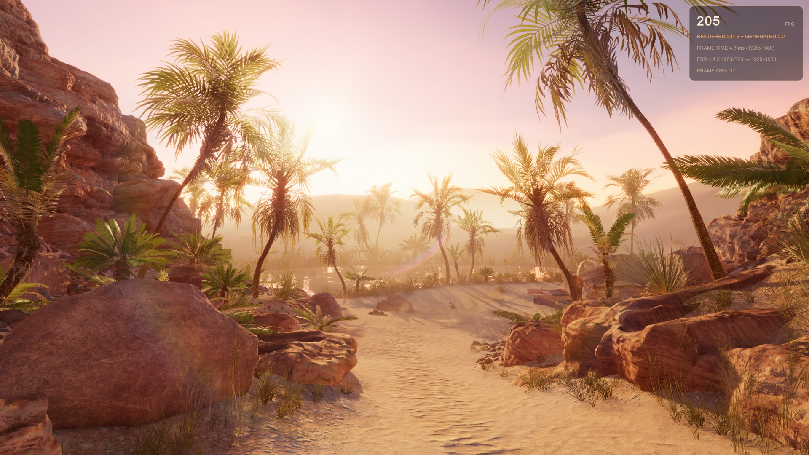

Demo and test project for [`com.achirastudio.fsr4`](https://github.com/AchiraStudio/unity-fsr4-wrapper) (AMD FSR 4 / 3.1 / 2.3 upscaling and experimental frame generation for URP). Every number and image below comes from a Windows Player build (Direct3D 12) of this project. Raw data is in [`Docs/data`](Docs/data).

| | |
|---|---|
| Scene | Unity's Oasis sample (copy in `Assets/FSRShowcase`) |
| Tested on | Unity **6000.7.0b9** (6.7 beta, URP 17.7) and **6000.6.8f1** (6.6, URP 17.6) |
| Test machine | Radeon RX 9060 XT 16 GB (RDNA 4, driver 32.0.32015), Ryzen 5 4500, Windows 11, 1920x1080 @ 144 Hz |
| Method | Scripted Player run (`-fsr-run`), 3 to 6 s averages per setting, 100+ frames of temporal convergence before each screenshot |

## Results at a glance

| Question | Result |
|---|---|
| Do FSR 4, 3.1 and 2.3 work in every quality mode? | **Yes.** 15 of 15 combinations produce the right render resolution and a clean image ([section 1](#1-fsr-quality-modes)). |
| Do the quality modes raise the frame rate? | **When the GPU is the limit: yes**, 1.9x (Quality) to 4.3x (Ultra Performance). **When the CPU is the limit: no**, because the render resolution is not the bottleneck ([section 2](#2-performance)). |
| Does split-screen work? | **Yes.** Two views, one FSR context each, correct images and scaling ([section 3](#3-split-screen)). |
| Does frame generation work and show in the FPS counter? | **Yes**, rendered, generated and presented FPS are shown separately. It gives **1.6x when GPU-bound** and **about 1.0x when CPU-bound**, because it adds 3 to 5 ms to every real frame ([section 4](#4-frame-generation)). It never doubles FPS here. |
| Does HUD ghost under FSR or frame generation? | **FSR alone: no.** **Frame generation: faint artifacts on fast-moving HUD edges.** HUD-less input is active and reduces them slightly (3 to 4 %), not fully ([section 5](#5-hud-ghosting)). |
| Pink or stuck screen on GPUs without FSR 4 | **Fixed** in the package: failed providers fall back automatically, tested with simulated failures ([section 6](#6-pink-screen-fix-and-fallback)). |
| Unity 6.6 and 6.7 | Package compiles with 0 errors on both; a real 6.6 Player ran all 15 modes ([section 7](#7-unity-66-and-67)). |

## 1. FSR quality modes

All three FSR generations were run at all five quality modes on the same camera. FSR 4 (4.1.2), FSR 3.1 (3.1.6) and FSR 2.3 (2.3.4) were each confirmed through the wrapper's provider read-out, not just requested.

| Mode | Scale | Render resolution (1080p output) |
|---|---|---|
| Native AA | 1.0x | 1920 x 1080 |
| Quality | 1.5x | 1280 x 720 |
| Balanced | 1.7x | 1129 x 635 |
| Performance | 2.0x | 960 x 540 |
| Ultra Performance | 3.0x | 640 x 360 |

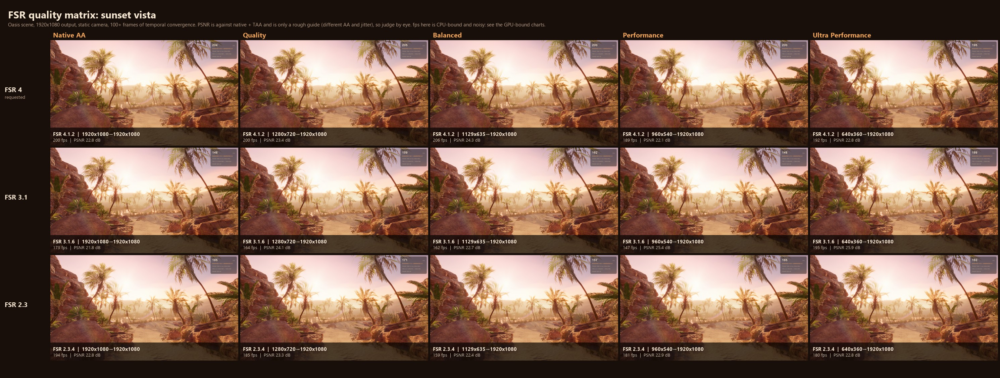

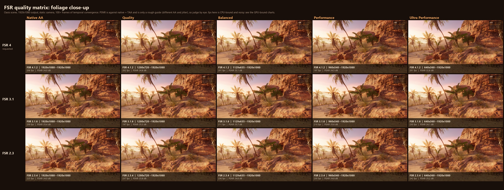

Zoomed on thin grass and palm leaves (the hardest content for an upscaler). FSR 4 keeps individual blades even at Ultra Performance; bilinear at 50 % is blocky.


Unity's built-in upscalers at comparable scales, for reference: [vista](Docs/images/legacy_vista.jpg), [foliage](Docs/images/legacy_foliage.jpg). The PSNR figures on the collages are against native + TAA and are only a rough guide (different anti-aliasing and jitter); judge by eye.

## 2. Performance

**At 1080p this scene is CPU-bound** on the test machine (Ryzen 5 4500 with a much faster GPU), so every mode lands in the same band and the quality modes cannot help. Native TAA runs at 195 to 216 fps, FSR modes at 147 to 242 fps, and even bilinear at 50 % gets only 201 to 246 fps.

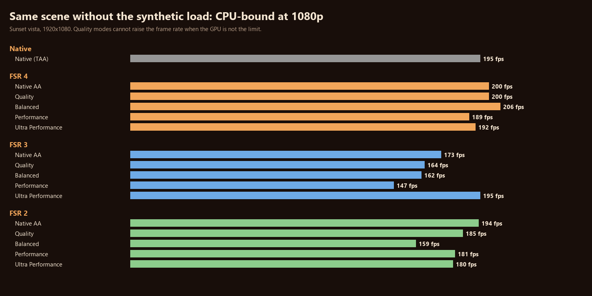

To measure what the upscaler does for a GPU-bound game, the showcase has a clearly synthetic **render-resolution GPU load** (a full-screen shader pass before the upscaler, slider "Synthetic GPU load" in the Overlays tab, `-fsr-load` on the command line). Its cost scales with pixel count, like heavy shading in a real game. At the setting used here, native 1080p runs at about 41 fps.

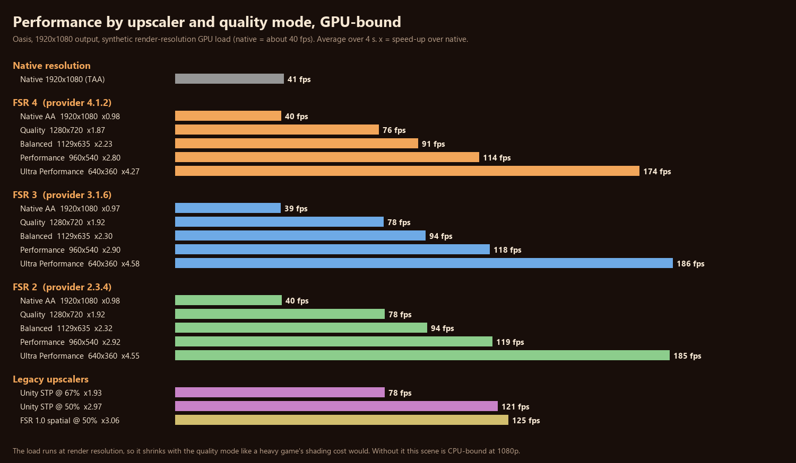

| fps, GPU-bound | Native AA | Quality | Balanced | Performance | Ultra Perf. |
|---|---|---|---|---|---|
| FSR 4.1.2 | 40 | 76 (1.9x) | 91 (2.2x) | 114 (2.8x) | 174 (4.3x) |
| FSR 3.1.6 | 39 | 78 (1.9x) | 94 (2.3x) | 118 (2.9x) | 186 (4.6x) |
| FSR 2.3.4 | 40 | 78 (1.9x) | 94 (2.3x) | 119 (2.9x) | 185 (4.5x) |
| Unity STP @ 67 / 50 % | | 78 | | 121 | |
| FSR 1.0 spatial @ 50 % | | | | 125 | |

Native 1080p TAA: 41 fps. FSR 4 Native AA is slightly slower than native TAA (40 vs 41) because of the ML pass. FSR 4 costs a little more than FSR 3.1 or 2.3 per frame, and looks better.

## 3. Split-screen

Two base cameras, each upscaled by its own FSR context (the debug HUD lists both). Each half is 960 x 1080 output.

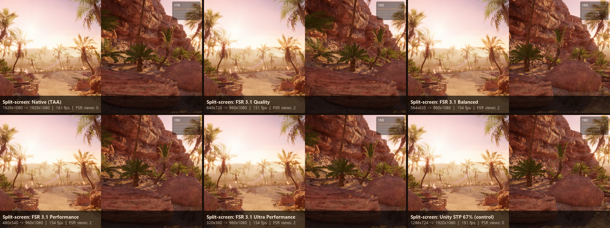

| fps | Native TAA | FSR Quality | Balanced | Performance | Ultra Perf. |
|---|---|---|---|---|---|
| GPU-bound (synthetic load), FSR 4 | 38 | 68 | | 96 | 136 |
| CPU-bound (no load), FSR 3.1 | 161 | 151 | 154 | 154 | 154 |

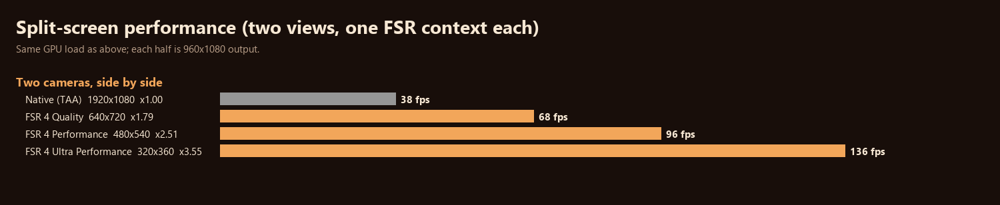

Reading it: with the GPU as the limit, split-screen scales like single view (1.8x to 3.6x). Without load it is CPU-bound at about 150 fps: two cameras mean two culls and two shadow passes, and each FSR view adds a little CPU cost, so FSR is about 4 to 10 % slower than native there and Unity's STP (191 fps) is faster. Frame generation pauses automatically while two or more cameras share the screen.

## 4. Frame generation

The performance overlay (top right, `F1`) shows **rendered + generated = presented** frames per second, measured by `FSR4FrameRateMeter`.

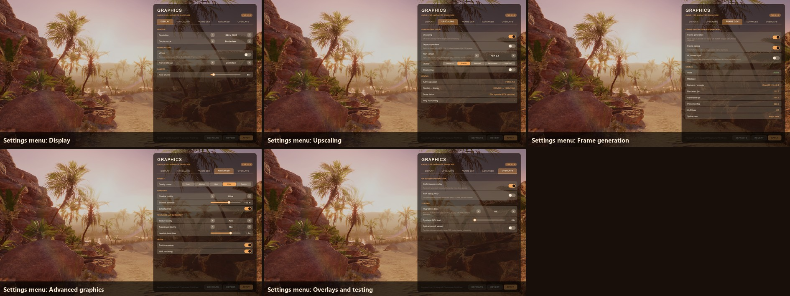

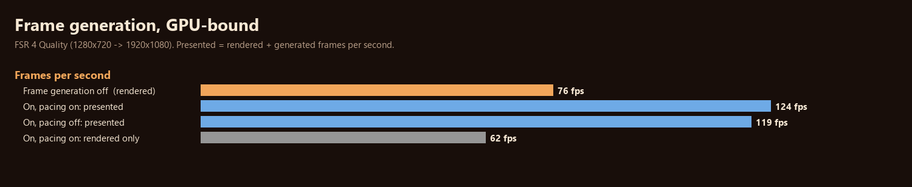

| Scenario | Frame gen off | Frame gen on (rendered + generated) | Presented | vs off |
|---|---|---|---|---|
| GPU-bound, FSR 4 Quality | 76 | 62 + 62 | 123 | **1.6x** |
| GPU-bound, pacing off | 76 | 60 + 60 | 119 | 1.6x |
| CPU-bound 1080p, FSR 3.1 Quality | 210 | 99 + 99 | 198 | **0.9x to 1.0x** |
| CPU-bound, pacing off | 210 | 100 + 100 | 199 | 0.95x |
| CPU-bound, HUD-less on | 210 | 111 + 111 | 222 | 1.05x (run-to-run variance) |

**Why it is not 2x.** Turning frame generation on stretches the real frame from 4.7 ms to about 10 ms at 1080p CPU-bound (and from 13 to 16 ms when GPU-bound). That extra 3 to 5 ms per real frame is what cancels most of the doubling. The native plugin's own log (`Docs/data/FSR4FrameGen.perf.log`) shows the time inside its present hook: about 8.5 ms per real frame, of which 3.5 ms is the deliberate pacing wait. **Switching pacing off did not shorten the frame** (rendered fps stayed at about 99), so the cost is not the pacing itself. It sits in the present path and the extra GPU work (the plugin copies the backbuffer, interpolates, and issues more than one `Present` per real frame to keep Unity's backbuffer index valid). Where exactly it goes was not profiled further.

Practical guidance from these numbers: frame generation pays off when the GPU is the limit and the base rate is below about 100 fps (1.6x here); on a CPU-bound scene at 200+ fps it gains nothing, so leave it off. Pacing is left on by default because it did not change the rate in either case and keeps generated and real frames evenly spaced. A lower-overhead present path is the main open item (see [limitations](#known-limitations)).

## 5. HUD ghosting

`F4` cycles an animated HUD stress panel (bouncing ball, scrolling ticker, moving marker, growing bar, rotating dial) in three forms: **UI Toolkit overlay**, **screen-space camera canvas** and **world-space canvas**. Frame generation only exists in the swapchain, so the frame-generation captures are **desktop captures** (`Tools/desktop-capture.ps1`), not in-engine screenshots.

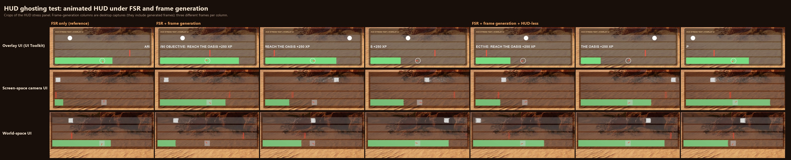

Zoomed on the ball track (screen-space camera UI), four frames each:

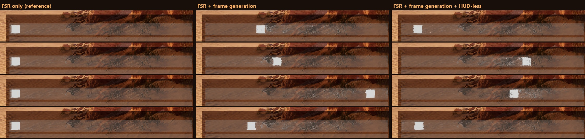

- **FSR alone:** the HUD is drawn after upscaling (overlay) or composited cleanly (canvas), so it is sharp and does not ghost.
- **Frame generation:** generated frames show small crumbling at the trailing edge of fast-moving HUD elements, over a busy background.
- **HUD-less input** (`FSR4HudlessFeature`, D3D12, SDR) is **active** with the rebuilt `FSR4FrameGen.dll` and reduces that slightly. Speckle energy next to the ball (mean of 8 desktop captures, lower is cleaner), from [`Docs/data/hud_speckle.json`](Docs/data/hud_speckle.json):

| HUD type | FSR only (reference) | Frame gen | Frame gen + HUD-less |
|---|---|---|---|
| Overlay UI | 5.40 | 4.92 | 4.78 |
| Screen-space camera | 8.31 | 8.23 | 7.95 |
| World-space | 5.34 | 4.93 | 4.75 |

The HUD-less reduction (3 to 4 %) is consistent in direction but within one standard deviation of the capture-to-capture spread, so treat it as a small improvement, not a fix. The shipped `FSR4FrameGen.dll` in older package commits is too old for HUD-less (status line: "FSR4FrameGen.dll is too old"); rebuild with `Native~/build.bat`.

## 6. Pink screen fix and fallback

**Cause.** A FidelityFX context is created lazily on the render thread. If creation or every dispatch failed (a provider the GPU cannot run, a size or flag the driver refuses), the native side simply returned and the upscaler's output texture stayed unwritten, which shows as a pink or black image that never recovers. The managed side only learned about it afterwards and did nothing.

**Fix (package).**
1. Each provider is **probed once** with a throw-away context before first use.
2. A provider that fails (probe, creation, or every dispatch) is **blocked**, and the next one is used: FSR 4 > FSR 3.1 > FSR 2.3 > automatic.
3. A new context's output is used only **after the render thread confirms** the context exists; until then the frame keeps the un-upscaled colour.
4. If nothing works, the upscaler reports itself unsupported (`FSR4Upscaler.hasFailed`, `runtimeFailureReason`) and records no pass; this demo then switches to Unity's STP.

**Tested** in the Player with simulated failures (`-fsr4-simulate-failure[=probe|all]`):

| Switch | What fails | Result |
|---|---|---|
| `-fsr4-simulate-failure=probe` | the first provider's probe | falls over to FSR 3.1.6, normal image ([log](Docs/data/failover_sim_probe.log)) |
| `-fsr4-simulate-failure` | creation on the render thread (`ffxCreateContext` code 4) | blocks that provider, recovers with a working one ([log](Docs/data/failover_sim_render.log)) |
| `-fsr4-simulate-failure=all` | every provider | upscaler disables itself, demo drops to STP, normal image ([log](Docs/data/failover_sim_all.log)) |

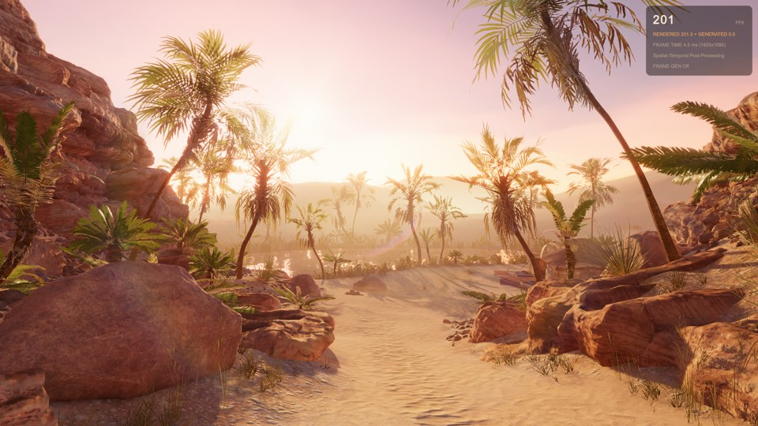

Also in the demo: `-fsr-reset` clears saved settings, `-fsr-safe` starts with Unity's STP and no frame generation, and `Hidden/Shader Graph/FallbackError` is now in *Always Included Shaders* (the first build logged "fallback shader not found" for VFX shaders, which can show as pink). On a machine without FSR 4 hardware, `Auto` already chooses FSR 3.1; this was verified only on a Radeon RX 9060 XT, with the non-FSR 4 paths exercised through the simulations above, not on other GPUs.

## 7. Unity 6.6 and 6.7

The package selects its registration API at compile time (`FSR4_UPSCALER_ID_API`, set for `com.unity.render-pipelines.core` 17.7+), so one code base serves both.

| | 6000.6.8f1 (URP 17.6) | 6000.7.0b9 (URP 17.7) |
|---|---|---|
| Package compiles | 0 errors, 0 warnings | 0 errors (Unity's `UAL0010` / `UAL0013` static-state warnings only) |
| Registered and selectable | yes ("AMD FSR 4 (Custom Wrapper)") | yes (`achirastudio.fsr4`) |
| Real D3D12 Player | FSR 4.1.2, 3.1.6, 2.3.4 x 5 modes, resolutions correct ([log](Docs/data/unity66_compat.log)) | full showcase |

On 6.6 the URP asset needs an `FSR4Options` sub-asset (created automatically when you pick the upscaler in the asset inspector).

## 8. In-game settings menu

`Esc` opens a graphics menu in the scene's palette: **Display** (resolution, window mode, VSync, frame cap, FOV), **Upscaling** (on/off, legacy upscalers, FSR version, quality, sharpening, live status), **Frame Gen** (frame generation, pacing, HUD-less, live status), **Advanced** (presets, shadows, textures, anisotropy, LOD, post-processing, HDR) and **Overlays** (FPS overlay, FSR debug HUD, HUD stress test, synthetic GPU load, split-screen).

Hotkeys: `Esc` menu, `F1` performance overlay, `F2` FSR debug HUD, `F3` split-screen, `F4` HUD stress test.

## Run it yourself

1. Open the project with Unity 6000.7.0b9 and open `Assets/FSRShowcase/Scenes/FSR_Showcase.unity`. (In the Editor, which runs on D3D11 by default, FSR reports that it needs Direct3D 12 and the menu uses STP.)
2. Build with *File > Build Profiles* (Windows, D3D12). A first build is slow (large sample assets, shaders).
3. Scripted run, from the build folder:

```
FSRShowcase.exe -fsr-run matrix,perf,motion,splitscreen,framegen,hud,menu -fsr-out <folder> [-fsr-load 1.0] [-fsr-res 1920x1080]
```

Steps: `smoke`, `matrix`, `perf`, `motion`, `splitscreen`, `framegen`, `hud`, `menu`. Each writes PNGs and `results.json`.

4. For frame-generation and HUD captures run the desktop watcher at the same time (it keeps the game window on top):

```
powershell -File Tools\desktop-capture.ps1 -OutDir <folder>
```

5. Build the collages and charts: `python Tools/compose.py <folder> <out>` and `python Tools/ghosting.py <folder> <out.jpg>` (needs Pillow and NumPy).

| Flag | Purpose |
|---|---|
| `-fsr-reset`, `-fsr-safe` | clear saved settings; start with STP and no frame generation |
| `-fsr4-simulate-failure[=probe\|all]` | exercise the fallback path |
| `-fsr4-hud`, `-fsr4-framegen`, `-fsr4-hudless`, `-fsr4-benchmark` | package switches (debug HUD, frame generation, HUD-less, benchmark) |

## Known limitations

- **Frame generation overhead.** It adds about 3 ms (GPU-bound) to 5 ms (CPU-bound, 1080p) to every real frame, so the net gain is 1.6x when GPU-bound and about none when CPU-bound. The cause is in the present path and was not isolated; pacing is not responsible. A lower-overhead present path is not implemented.
- **HUD-less** helps only slightly in these tests and is D3D12 and SDR only.
- **One test GPU.** All results are from a Radeon RX 9060 XT. FSR 3.1 and 2.3 ran on it, but NVIDIA, Intel and older Radeon GPUs were not available; their failure paths are covered by simulation only.
- **Windowed Player cannot exceed the desktop**, so the GPU-bound tests use the synthetic load at 1080p rather than a real 4K output.
- Unity 6.7 prints `UAL0010` / `UAL0013` static-state warnings for this package and the demo. They do not affect behaviour.

## Layout and licenses

| Path | Contents |
|---|---|
| `Assets/FSRShowcase/` | Showcase scene (Oasis copy), settings menu, overlays, GPU load feature, split-screen rig, HUD stress test, scripted runner |
| `Docs/` | Images and raw data behind this page |
| `Tools/` | `desktop-capture.ps1`, `compose.py`, `ghosting.py` |
| `Assets/Scenes/`, `Assets/SharedAssets/`, `Assets/Tutorials/` | Unity sample content, unmodified |
| `ProjectSettings/` | D3D12 only, `ENABLE_UPSCALER_FRAMEWORK`, MSAA off |

Code in `Assets/FSRShowcase/` and `Tools/` is MIT, like the package. Unity's sample content is not covered by that license; check Unity's terms before redistributing it. The FidelityFX DLLs are AMD's; see the package for their license.
